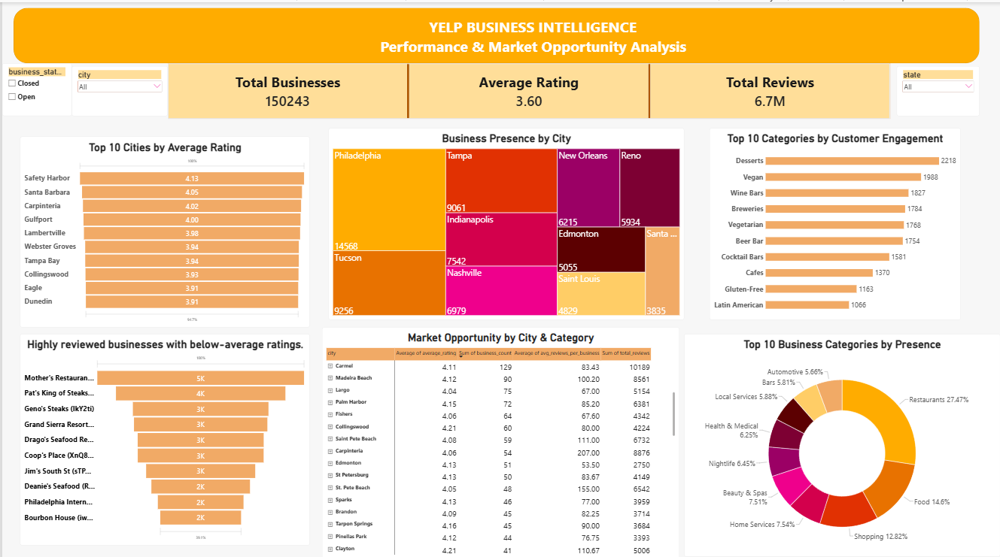

# Yelp Business Intelligence: Performance & Market Opportunity Analysis

An end-to-end data analytics project using Python, SQL Server, and Power BI to analyze business performance, customer engagement, market structure, and city-category opportunities using Yelp business data.

## Executive Summary

**Question:** Which city-category segments should a business owner or investor evaluate first, based on observed ratings, review activity, and business presence?

**Answer:** Of 150,243 businesses, 561 city-category combinations met the project's screening criteria. New Orleans Historical Tours (54 businesses, about 179 reviews per business) and Santa Barbara Wine Tours (55 businesses, 4.70 average rating) stand out and merit further evaluation. These are screening results, not proof of unmet demand.

[Read the one-page executive memo](docs/Yelp_Market_Expansion_Executive_Memo_Revised.pdf)

## Business Problem

Yelp contains information on businesses, ratings, and customer reviews across different cities and business categories. However, raw business data does not directly reveal where business activity is concentrated, which categories attract stronger customer engagement, or where potential market opportunities exist.

This project transforms the Yelp business dataset into actionable insights by examining market presence, customer engagement, business performance, and city-category opportunities.

## Project Objectives

- Analyze business distribution across cities and categories.
- Identify cities with strong average business ratings.
- Measure customer engagement using review activity.
- Identify high-performing businesses and businesses with high review volume but lower ratings.
- Identify highly rated businesses with relatively low review visibility.
- Identify city-category combinations with strong ratings and customer engagement as potential market opportunities.
- Develop an interactive Power BI dashboard to communicate the findings.

## Business Questions

**Market Analysis**
1. Which cities have the highest number of businesses?
2. Which cities have the highest average rating?
3. Which cities have the highest customer engagement based on review volume?
4. Which cities have high business concentration but relatively low customer engagement?

**Category Analysis**
5. Which business categories have the largest business presence?
6. Which categories have the highest average rating?
7. Which categories generate the highest review volume?
8. Which categories combine strong ratings with strong customer engagement?

**Business Performance**
9. Which businesses are the top performers?
10. Which highly reviewed businesses have below-average ratings?
11. Which businesses have high ratings but relatively low review volume?

**Market Opportunity**
12. Which city-category combinations show the strongest business opportunity?

## Dataset

The project uses the **Yelp Open Dataset** (Business file), downloaded from Kaggle:
<https://www.kaggle.com/datasets/yelp-dataset/yelp-dataset>

The raw Yelp files are not included in this repository. Download them from Kaggle and review Yelp's dataset terms before reuse.

Fields used: business ID, name, address, city, state, postal code, latitude/longitude, star rating, review count, open/closed status, and business categories.

**Coverage:** The dataset is a curated set of North American metropolitan areas (state codes include Canadian provinces such as Alberta), not a random sample of all businesses.

## Data Preparation

The raw business data (150,346 records) was processed with Python and Pandas before loading into SQL Server.

- **Missing categories:** 103 records (0.07%) had no category and were removed, since category is required for category-level analysis. This left 150,243 records.
- **Whitespace:** 49 city values and 150 business names had leading or trailing whitespace and were cleaned to prevent duplicate groupings.
- **Business status:** Created a readable `business_status` field ("Open"/"Closed") from the raw `is_open` indicator.
- **Category normalization:** The comma-separated `categories` field was split into a category dimension table and a business-category junction table.
- **Validation:** Confirmed zero duplicate business IDs, zero ratings outside 1-5, zero negative review counts, and zero invalid `is_open` values.
- **Reconciliation:** After loading into SQL Server, row counts for every table were compared with the Python-side counts.

## Data Integration & Connectivity

- **Kaggle to Python:** Yelp Open Dataset downloaded from Kaggle and loaded with Pandas.
- **Python to SQL Server:** Cleaned tables loaded with SQLAlchemy and PyODBC.
- **SQL Server to Power BI:** The Power BI report is built on the SQL Server analysis views.

### Final Analytical Dataset

| Dataset | Records |
|---|---|
| Business | 150,243 |
| Category | 1,311 |
| Business-Category Relationships | 668,549 |

## Tools & Technologies

| Area | Tools |
|---|---|
| Data Acquisition | Kaggle |
| Data Preparation | Python, Pandas, NumPy |
| Database | Microsoft SQL Server |
| SQL Analysis | T-SQL, CTEs, Joins, Aggregations, Views |
| Data Visualization | Microsoft Power BI |
| Data Modelling | Power BI Data Model, DAX |
| Version Control | Git, GitHub |

## Project Workflow

**Data Acquisition → Data Preparation → SQL Database → Data Validation → Business Analysis → Power BI Dashboard → Business Insights**

## SQL Analysis

The cleaned datasets were loaded into SQL Server and analyzed in four areas: market analysis, category analysis, business performance, and market opportunity. The full queries are in [`sql/Yelp_Business_Analytics.sql`](sql/Yelp_Business_Analytics.sql).

### Market Opportunity: Screening Criteria

A city-category combination counts as a **market opportunity** if it meets all three thresholds:

- At least **10 businesses** (so one or two outliers do not drive the result)
- Average rating of **4.0 or higher**
- Average of **50 or more reviews per business**

These are screening criteria. They show where ratings and review activity are strong, not where demand is unmet or where competition is low.

### SQL Views

| SQL View | Purpose |
|---|---|
| `vw_Business_Analysis` | Business-level analysis and reporting |
| `vw_Category_Analysis` | Category-level performance and engagement |
| `vw_Market_Opportunity` | City-category opportunity analysis |

## Power BI Dashboard

An interactive Power BI dashboard presents market presence, customer engagement, business performance, and market opportunities.

**Components**
- KPI cards: Total Businesses, Average Rating, Total Reviews
- Market analysis: Business Presence by City, Top 10 Cities by Average Rating
- Category analysis: Top 10 Categories by Presence, Top 10 Categories by Customer Engagement
- Business performance: Popular but Weak Businesses
- Market opportunity: Opportunity by City and Category

**Interactive features:** City, State, and Business Status slicers with cross-filtering across visuals.

### Dashboard Preview



## Key Findings

### Market
- Philadelphia has the most businesses in the dataset: **14,566**.
- Safety Harbor, Florida has the highest average rating among cities with at least 100 businesses: **4.13**.
- Philadelphia has the highest total review volume: about **936K reviews**.
- New Orleans averages about **100 reviews per business**, indicating strong engagement intensity.

### Categories
- **Restaurants** is the largest category, with **52,268 businesses**.
- **Seafood** and **American (New)** show high engagement, with about **169** and **155 reviews per business**.
- Categories such as Walking Tours, Historical Tours, Distilleries, and Coffee Roasteries combine strong ratings with meaningful engagement.

### Business Performance
- Several highly reviewed businesses (1,000+ reviews) rate below the dataset average of about **3.60**.
- Highly rated businesses (4.5+) with 50 to 200 reviews were identified as potential hidden-visibility cases.

### Market Opportunity
- **561 city-category combinations** met the screening criteria above.
- Dataset-wide baselines: average rating 3.60, average 44 reviews per business.

| City | Category | Businesses | Avg. rating | Total reviews |
|---|---|---|---|---|
| New Orleans, LA | Historical Tours | 54 | 4.59 | 9,663 |
| New Orleans, LA | Walking Tours | 44 | 4.55 | 7,783 |
| Santa Barbara, CA | Tours | 86 | 4.65 | 5,949 |
| Santa Barbara, CA | Wine Tours | 55 | 4.70 | 2,962 |
| Nashville, TN | Historical Tours | 21 | 4.55 | 3,035 |

New Orleans Historical Tours recorded 9,663 reviews across 54 businesses, about 179 reviews per business, roughly **4 times** the dataset-wide average of 44.

Categories overlap: one business can appear in several categories (for example Tours and Wine Tours), so these rows are not independent opportunities.

## Limitations

- Yelp covers selected metropolitan areas and does not represent the full business population.
- Review counts are lifetime totals that measure platform activity, not unique customers. They are influenced by tourist traffic, visibility, and business age.
- Average ratings are unweighted: a business with 5 reviews counts the same as one with 5,000.
- The screening does not exclude closed businesses and does not measure closure rates, growth, or saturation.
- Businesses appear in multiple categories, so category totals overlap.
- The data is a single snapshot with no time trend.
- Ratings and review counts alone cannot establish competition, unmet demand, or profitability.

## Planned Improvements

- Re-run the opportunity screen on open businesses only, with a review-weighted rating.
- Add closure rate per segment as a risk indicator.
- Use review dates to measure engagement growth.
- Add category-overlap analysis for the top segments.

## How to Reproduce

1. Download the Yelp Open Dataset from Kaggle and place the Business JSON file where the notebook expects it.
2. Run `python/Yelp_Business_Analytics.ipynb` to clean the data and load it into SQL Server (update the connection settings for your machine).
3. Run `sql/Yelp_Business_Analytics.sql` to create the analysis queries and views.
4. Open the Power BI file and refresh it against your SQL Server database.

## Repository Structure

```
Yelp-Business-Intelligence-Performance-Market-Opportunity-Analysis/
├── README.md
├── python/
│   └── Yelp_Business_Analytics.ipynb
├── sql/
│   └── Yelp_Business_Analytics.sql
├── Dashboard/
│   ├── Yelp_Business_Analytics.pbix
│   └── dashboard_preview.png
└── docs/
    ├── Yelp_Market_Expansion_Executive_Memo_Revised.pdf
    └── data_dictionary.md
```

## Author

**Vyshnav P S** | Data Analyst
